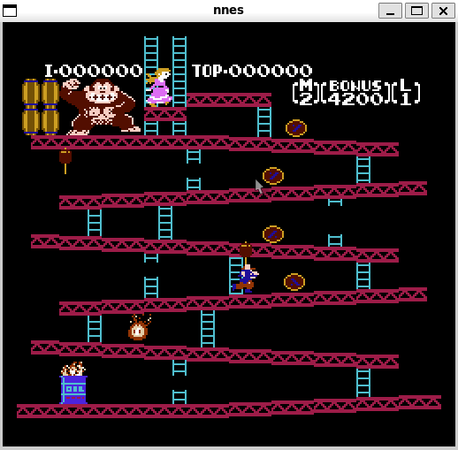

# NNES

A cycle-accurate NES emulator written in Rust. NNES implements the full 2A03 CPU, 2C02 PPU, and 2A03 APU with per-cycle accuracy, and is feature-complete for NROM (mapper 0) games, with plans to support additional mappers in the future.



## Features

- **Cycle-Accurate 6502 CPU**: Complete implementation of all official and unofficial opcodes with per-cycle timing
  - Finite state machine architecture (Fetch → Decode → Execute)
  - All addressing modes with correct cycle counts
  - Proper interrupt handling (NMI, IRQ, BRK) with interrupt hijacking
- **2C02 PPU Emulation**: Pixel-accurate rendering with proper timing
  - Background and sprite rendering with correct priority
  - Sprite evaluation and OAM DMA transfer
  - Accurate scanline and cycle timing
  - VBLANK and NMI generation
- **iNES ROM Support**: Cartridge loading with header validation
  - PRG-ROM, CHR-ROM, and CHR-RAM parsing (iNES and NES 2.0 headers)
  - Horizontal and vertical mirroring support
  - Battery-backed SRAM and trainer support
- **2A03 APU Emulation**: Cycle-accurate audio with all five channels
  - Pulse, triangle, noise, and DMC channels with nonlinear mixing
  - Frame counter with IRQ support and DMC DMA cycle stealing
  - 44.1 kHz audio output through SDL
- **Controller Input**: Keyboard-mapped NES controller emulation
- **Custom Palette Support**: Loadable .pal palette files

## Build System

The project uses [Cargo](https://doc.rust-lang.org/cargo/), the Rust package manager and build system.

### Prerequisites

- **Rust Toolchain** via rustup (tested with 1.87.0)
- **SDL2** development libraries

### Building

```bash
# Install SDL2 (Ubuntu/Debian)
sudo apt install libsdl2-dev

# Clone the repository
git clone git@github.com:Nathan5563/nnes.git
cd nnes

# Build in release mode
cargo build --release

# Run with a ROM file
cargo run --release -- path/to/your.nes
```

The executable is output to `target/release/nnes`.

### Controls

| NES Button | Player 1 | Player 2 |
|------------|----------|----------|
| D-Pad Up | W | Up Arrow |
| D-Pad Down | S | Down Arrow |
| D-Pad Left | A | Left Arrow |
| D-Pad Right | D | Right Arrow |
| A | G | . |
| B | F | , |
| Start | Space | Enter |
| Select | Left Shift | Right Shift |

## Architecture

### Project Structure

```
nnes/
├── Cargo.toml                           # Rust package configuration
├── build.rs                             # Build script
├── demos/
│   └── donkey_kong.png                  # Demo screenshot
├── palettes/
│   └── base.pal                         # Default NES palette
├── roms/                                # ROM files (not included)
├── scripts/
│   └── load-palette.py                  # Palette conversion utility
└── src/
    ├── main.rs                          # Entry point, SDL2 setup, game loop
    ├── nnes.rs                          # Emulator core orchestration
    ├── cartridge.rs                     # iNES parser and ROM handling
    ├── controller.rs                    # Keyboard input mapping
    ├── palette.rs                       # Color palette definitions
    ├── utils.rs                         # Bit manipulation utilities
    └── nnes/
        ├── cpu.rs                       # 6502 CPU core
        ├── ppu.rs                       # 2C02 PPU core
        ├── apu.rs                       # 2A03 APU core
        ├── cpu/
        │   ├── bus.rs                   # CPU memory bus
        │   ├── opcodes.rs               # Opcode definitions and tables
        │   └── bus/
        │       └── devices.rs           # Memory-mapped devices
        ├── ppu/
        │   ├── core.rs                  # PPU rendering logic
        │   ├── io.rs                    # PPU register I/O
        │   └── sprites.rs               # Sprite evaluation and fetching
        └── apu/
            ├── channels.rs              # Pulse, triangle, noise channels
            ├── dmc.rs                   # DMC channel and sample fetching
            ├── frame.rs                 # Frame counter and IRQ
            ├── io.rs                    # APU register I/O
            ├── mixer.rs                 # Nonlinear mixer and resampler
            └── units.rs                 # Envelopes, sweeps, length counters
```

## Emulator Design

### Master Clock Timing

The NES uses a master clock that drives all subsystems at different rates:

| Component | Divider | Effective Rate |
|-----------|---------|----------------|
| CPU | ÷12 | ~1.79 MHz |
| PPU | ÷4 | ~5.37 MHz |
| APU | ÷12 | ~1.79 MHz |

The APU shares the CPU clock (its triangle timer and frame counter run at
CPU rate; pulse timers divide down internally) and ticks first in each
CPU slot, so register writes settle at the end of the cycle. The NNES
struct also forwards cross-component signals each tick: the PPU's NMI
line, the APU's level-triggered IRQ line, and OAM/DMC DMA transfers.

```rust
pub fn tick(&mut self) {
    // PPU runs at master/4
    if self.master_clock % 4 == 0 {
        self.ppu.borrow_mut().tick();
        // ... NMI edge forwarding
    }

    // CPU and APU run at master/12
    if self.master_clock % 12 == 0 {
        self.apu.borrow_mut().tick();
        // ... DMC DMA service, IRQ level
        self.cpu.borrow_mut().tick();
        // ... OAM DMA forwarding
    }

    self.master_clock = self.master_clock.wrapping_add(1);
}
```

### CPU Architecture

The CPU uses a finite state machine to execute instructions with cycle accuracy:

| State | Description |
|-------|-------------|
| **Fetch** | Read opcode byte from memory at PC |
| **Decode** | Read operands based on addressing mode |
| **Execute** | Perform operation, write results |
| **Interrupt** | Service pending NMI/IRQ/BRK |

Interrupts are polled between instructions, with NMI taking priority over IRQ. The CPU properly handles interrupt hijacking when multiple interrupts occur simultaneously.

### PPU Rendering

The PPU renders 262 scanlines per frame (240 visible + 22 blanking):

- **Visible scanlines (0-239)**: Fetch and render background tiles and sprites
- **Post-render (240)**: Idle scanline
- **VBLANK (241-260)**: CPU can safely access VRAM, NMI triggered on line 241
- **Pre-render (261)**: Prepare for next frame, clear VBLANK flag

Sprite evaluation occurs during visible scanlines, with up to 8 sprites per scanline. Sprite 0 hit detection enables raster effects used by many games.

### Memory Map

| Address Range | Size | Description |
|---------------|------|-------------|
| $0000-$07FF | 2 KB | Internal RAM |
| $0800-$1FFF | — | RAM mirrors |
| $2000-$2007 | 8 B | PPU registers |
| $2008-$3FFF | — | PPU register mirrors |
| $4000-$4017 | — | APU and I/O registers |
| $4018-$401F | — | Test mode registers |
| $4020-$5FFF | — | Cartridge expansion |
| $6000-$7FFF | 8 KB | Cartridge SRAM |
| $8000-$FFFF | 32 KB | Cartridge PRG-ROM |

## Roadmap

- [x] Cycle-accurate 6502 CPU with all official opcodes
- [x] iNES ROM parsing and validation
- [x] Interrupt handling (NMI, IRQ, BRK)
- [x] PPU background rendering
- [x] PPU sprite rendering
- [x] APU audio emulation
- [x] Unofficial CPU opcodes
- [ ] Additional mappers (MMC1, MMC3, etc.)
- [ ] Save states
- [ ] Debugger UI with egui

## License

MIT License — Copyright © 2026 Nathan Abebe
